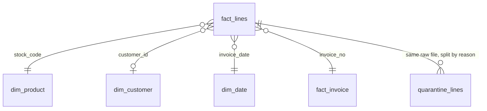

# E-commerce finance mart

Messy retail transactions go in. A normalized star schema, finance and customer marts, an Excel workbook and a self-serve sales explorer come out. Everything runs on one public dataset of 1,067,371 invoice lines from a UK online wholesaler (December 2009 to 9 December 2011).

**Try it:** [sales explorer](https://vasilendata.github.io/ecommerce-finance-mart/explorer/) (filter by period, country and customer type, export CSV) · [Excel workbook](docs/finance_workbook.xlsx) (live formulas, native charts) · [Tableau Public dashboard](https://public.tableau.com/app/profile/vasilen.kanchev/viz/E-CommerceFinanceMartSalesDashboard/E-CommerceFinanceMartsalesdashboard) · [metric definitions](docs/metrics.md) · [data quality report](docs/data_quality.md)

**Implementation scope:** Python and DuckDB run the complete pipeline. The [Databricks SQL port](databricks/README.md) reproduces the transformation layers. The BigQuery experiment described there loads the already-built monthly mart; it is not a port of the full pipeline. The checked-in implementation and verification SQL cover DuckDB and Databricks.

## Customer future-value extension

[Open the customer prediction report](https://vasilendata.github.io/ecommerce-finance-mart/customer-value/) · [method and reproducible commands](docs/customer_value.md)

The finance tables now feed a point-in-time customer study: predict repeat purchase and gross product spend over the next 90 days using only the preceding history. Fixed candidates are selected on January 2011; two later windows remain held out. Logistic regression achieved ROC-AUC **0.748 / 0.762** on **3,299 / 2,722** customer snapshots. The more complex revenue model lost to a past-spend baseline on validation, so the baseline was retained. All predictions, calibration diagnostics, source/code fingerprints, and the rejected-model comparison are published together. The tested batch scorer reuses a checksummed model bundle and refuses prediction dates preceding model selection.

This is historical research on public invoices, not measured retention impact or lifetime profit. The top-20% customer ranking describes subsequent revenue concentration, not uplift from an intervention. [Read the evidence and limitations](docs/customer_value.md).

## Operational change-capture extension

[Architecture, contract and recovery exercise](docs/OPERATIONAL_CDC.md) · [Real integration workflow](.github/workflows/operational-cdc.yml) · [Consumer](mart/cdc.py)

A separate synthetic-orders lab captures PostgreSQL changes through Debezium and Kafka, then applies current orders, daily finance totals, event audit and durable offsets in one DuckDB transaction. It covers corrections, cumulative refunds, cancellations, deletes and replay. The [12 November 2026 hosted exercise](docs/operational-cdc-20261112/README.md) passed **six checks over 11 captured records**, including source reconciliation, consumer exit before commit, connector SIGKILL/recovery and event-history rebuild. Connector restart through reconciliation took **13.521 seconds** in this single controlled run; this is not an uptime or recovery SLA. The original report and event bytes are retained. This synthetic extension does not change the historical UCI workbook, explorer or customer-value results.

## Subscription revenue analytics extension

[View the decision explorer](https://vasilendata.github.io/ecommerce-finance-mart/subscriptions/) · [inspect the contract, lineage and proof](docs/SUBSCRIPTIONS.md)

A separate synthetic subscription product explains why recurring run rate, invoices and collected cash disagree. Versioned source records and explicit knowledge cutoffs preserve the original close while later corrections restate the appropriate business periods. Python/DuckDB builds effective-dated subscription states, customer-level MRR movements and a cash/invoice reconciliation, then publishes HTML, JSON and CSV outputs together. The checked-in three-cutoff exercise passed **33 blocking reconciliations**; hand-computed fixtures cover all five MRR movement types, duplicate replay, late corrections, split payments, refunds and interrupted publication. Bookings and recognized revenue are explicitly excluded because the necessary source contracts are absent. This is synthetic correctness evidence, not measured business impact.

## What it demonstrates

| Skill | Where to look |
|---|---|
| Data normalization | `sql/10_staging.sql`, `sql/20_classify.sql`, `seeds/`: codes, descriptions, countries and line types cleaned, every rejected row kept with a reason |
| SQL | Four layered SQL files in DuckDB: staging, classification, core star schema, marts. Window functions, filtered aggregates, correlated `exists`, cohorts |
| Transactional and financial data | Invoices, credit notes, postage, fees, discounts and bad debt separated from product revenue. Kept and quarantined amounts reconcile to the raw file to the penny |
| Data models | `fact_lines`, `fact_invoice`, `dim_product`, `dim_customer`, `dim_date`, plus marts below |
| Analysis and charts | Findings below, drawn from the marts |
| Excel | `docs/finance_workbook.xlsx`: seven sheets, every KPI a formula, segment rollups with `SUMIF` and `COUNTIF`, three native charts. Formula results are checked against the SQL |
| Self-serve data product | `docs/explorer/`: one static page, sentence-style filters, shareable URLs, CSV export, a table behind every chart, definitions in the open |

## What the data showed

**Two rapid reversals account for a large share of credit-note value.** On 18 January 2011 one customer entered 74,215 ceramic jars (GBP 77,184) and a credit note for the same quantity followed 16 minutes later. On 9 December 2011 another entered 80,995 paper crafts (GBP 168,470) and reversed it after 12 minutes. A rule flags any return that mirrors a sale by the same customer within 60 minutes. It finds 989 such lines worth GBP 312,458, which is 44% of all credit-note value. The reported return rate is 3.65%. Excluding those reversals from both credit notes and sales gives 2.09%. January 2011 drops from 13.7% to 2.3%. The timestamps suggest corrections, but do not prove why each order was reversed.


**Revenue edged up while orders fell.** For the same eleven months (January to November), net product revenue rose 2.3% from 2010 to 2011 (GBP 8,377,738 to 8,572,828) while orders fell 3.7% (18,077 to 17,407). The average order grew 7% instead (GBP 476 to 509). December 2011 is excluded because the data stops on the 9th.


**Revenue is concentrated.** 85.5% of gross sales are UK. Among the 5,852 registered customers with a purchase, the 1,470 "Champions" (25%) account for 70.6% of their revenue. 1,040 of 4,720 products (22%) make 80% of product revenue. About 13% of sales come from guest checkouts that have no customer id.

**Repeat purchasing is less common in later months.** Across observable monthly cohorts from 2010 on, an average of 20.4% buy in the following month and 16.7% buy in month twelve. These are month-specific retention rates, not the share that ever returns.


## Data model



`fact_lines` holds 1,027,008 kept lines, each typed (sale, return, shipping, discount, fee and so on). `quarantine_lines` holds 40,363 rejected lines with a reason. Marts: `mart_monthly`, `mart_customer_rfm`, `mart_cohort`, `mart_product`, `mart_country`, and the cube behind the explorer.

## What normalization fixed

| Problem in the raw file | Count |
|---|---:|
| Stock codes written in more than one case or with stray spaces | 174 |
| Descriptions with extra whitespace | 247,906 rows |
| Products with conflicting descriptions | 596 |
| Country labels like EIRE, RSA, USA mapped to clean names and regions | 18,694 rows |
| Exact duplicate rows quarantined | 34,335 |
| Zero or negative price lines, test products, zero-price non-product lines quarantined | 6,028 |
| Guest lines with no customer id (kept for revenue, left out of customer metrics) | 229,207 |

Full table and the 14 blocking checks: [docs/data_quality.md](docs/data_quality.md). The build stops if any check fails, for example if kept plus quarantined rows or amounts stop matching the raw file.

## Decisions and limits

- **Exact duplicates are treated as double-posted.** The 34,335 rows carry a net amount of GBP 431,717 across sales, credit notes and other line types. That net amount is not the increase in gross product sales that retaining the rows would produce. They stay in `quarantine_lines`, so the assumption can be reversed in one place.
- **The 60-minute reversal rule is a judgment.** It needs the same customer, product, quantity and unit price. Later returns remain in the adjusted rate; the rule cannot establish the underlying reason for a credit note. Reversed orders stay in the fact table, flagged, never deleted.
- **December 2011 is 9 days.** Charts and the workbook mark it as partial. The first data month cannot separate new from existing customers, so new-customer counts start in January 2010.
- **Returns are timing, not cohorts.** A month's return rate is credit notes issued that month over sales that month. It is not the share of that month's sales that came back.
- **Zero-sales months remain visible.** Returns-only months keep their negative net revenue in the monthly mart. Ratios with zero denominators are NULL, and observed cohort months with no purchases have zero retention rather than disappearing.
- **Rebuild safety.** SQL layers and blocking checks run in one transaction, so a failed rebuild preserves the previous database. Explorer charts include negative revenue within their axes.
- **RFM edges are approximate.** Many customers share the same order count, so quintile boundaries are broken by spend and id. Treat segment sizes as a ranking aid.
- **Practice data, not employer data.** This is the public UCI Online Retail II dataset (CC BY 4.0) for one UK wholesaler, in GBP. No figure here comes from any company I have worked for.
- **Explorer scope.** The product table follows the period only, not country or customer type. Active customers are counted per month and cannot be summed across months, so the explorer shows a monthly average.

## Run it

```bash
pip install -r requirements-dev.txt
python -m mart.cli data      # downloads the 45 MB UCI file and flattens it (about 2 minutes)
python -m mart.cli all       # SQL layers, checks, report, workbook, explorer, charts (about 15 seconds)
python -m pytest -q          # fixture tests; the real-data test skips if data is absent
node --test tests_js/*.test.mjs  # explorer axis regressions (Node.js 22)
```

The SQL layers alone rebuild 1.07 million rows in about 7 seconds on a laptop-class machine. LibreOffice, if installed, recalculates the workbook so the formula results show in any viewer; without it Excel recalculates on open.

## Tests

`tests/` builds a 21-line fixture that covers every line class and checks each rule against hand-computed values: duplicate, missing key, test product, bad debt, non-product code, return, credit note with positive quantity, zero quantity, same-hour reversal versus a real return two days later, guest customers, cohorts, RFM and the monthly finance table. Writing the fixture exposed a real bug: a month with no returns produced a NULL net revenue. The full-data test confirms the checks pass on all 1,067,371 rows. A separate test deletes one fact row and proves the reconciliation check fails.

CI (`.github/workflows/ci.yml`) runs lint, fixture tests and explorer regressions on every push. The [8 November 2026 rebuild record](docs/rebuild-2026-11-08.json) records the historical run of 38 Python tests, six Node tests and 14 blocking checks, with source provenance and artifact checksums.

### Historical management decision brief

[Read the same-release management brief](docs/releases/2026-11-11/management.md) ([machine-readable report](docs/releases/2026-11-11/management.json), [complete release manifest](docs/releases/2026-11-11/manifest.json)). It compares the latest complete month with its prior month and year where covered, reconciles net-revenue changes into gross-sales and returns movements, decomposes sales into order-volume and basket-value contributions, and ranks country contributions. These are descriptive arithmetic explanations, not causal claims.

The brief proposes specific investigations and a controlled retention pilot, with the missing traffic, margin, stock, return-reason and randomized-control evidence needed before action. It does not claim implemented actions, profit, ROI or retention uplift. Source coverage must be declared; a missing feed must not be called a zero-sales month. Partial boundary months are excluded, and zero denominators remain undefined. The customer-value models and their held-out evidence are unchanged.

To reproduce this historical brief without LibreOffice (the destination must be new):

```bash
python -m mart.decisions --raw data/raw_online_retail_II.csv --coverage-start 2009-12-01 --coverage-end 2011-12-09 --output dist/management
```

### Validated artifact bundle

The current workbook, explorer, three charts, quality report and management brief come from [the verified 11 November 2026 full-source build](https://github.com/VasilenData/ecommerce-finance-mart/actions/runs/43061316297): 77 Python tests, six Node tests, all 14 blocking checks and 124 recalculated workbook/SQL comparisons passed. [Download the complete immutable release](docs/releases/2026-11-11/finance-mart-release.zip), inspect its [manifest](docs/releases/2026-11-11/manifest.json), or see the [current download mapping](docs/current-release.json). All eight outputs share one frozen source. The manifest records build revision `35f3001b`, preceding this artifact-only publication. This is a DuckDB release; the Databricks port was not rerun.

The manual `full-build.yml` downloads the source, runs full-data and browser regressions, then builds the workbook, explorer, three charts, quality report and management decision brief together. Complete source coverage is explicitly declared as 1 December 2009 through 9 December 2011 (exclusive), so the partial December 2011 month is not compared. LibreOffice recalculates workbook formulas; the release fails on formula errors or a mismatch between cached monthly finance/summary/segment cells and SQL. A successful run uploads one versioned Actions artifact for 30 days. It does not automatically overwrite the published website or create a GitHub Release.

For the same local bundle (requires LibreOffice on PATH):

```bash
python -m mart.release --output dist/release --coverage-start 2009-12-01 --coverage-end 2011-12-09
```

The output directory must be new. Generation takes place in a temporary directory and is promoted only after validation. Every output reads a private frozen copy of the source CSV. `manifest.json` fingerprints that consumed copy, not a potentially replaced original path, plus the Git revision, LF-normalized hashes of Python/SQL/seed files (including local edits; CRLF becomes LF only for code hashing), package versions, row counts, reconciliation results, workbook validation and every downloadable artifact. An upstream producer should atomically replace its source file; the copy is not a transaction with an external producer. The [8 November manifest](docs/release-2026-11-08.json) and [earlier standalone management evidence](docs/management/manifest.json) remain historical records; current downloads are identified by `docs/current-release.json`. This workflow validates DuckDB artifacts and does not rerun the Databricks port.

## Layout

```
sql/        four SQL layers, run in order
seeds/      country map and non-product stock code types
mart/       pipeline, checks, Excel, explorer, charts, CLI
tests/      fixture tests and the real-data test
docs/       explorer, workbook, metrics, data quality report, charts
```

## Also on Databricks Free Edition

The four SQL layers are ported to Spark SQL in [`databricks/`](databricks/). The original verification matched 20 of 20 counts and totals against DuckDB. The subsequent zero-denominator and cohort-grid fixes are mirrored in the port but have not been rerun on Databricks. See [databricks/README.md](databricks/README.md) for the recorded evidence, dialect changes and limits.

## Open-source tools used

DuckDB (all SQL and the star schema), pandas (reading the source workbook), openpyxl (building the workbook with formulas and charts), matplotlib (README charts), pytest and ruff (tests and lint), LibreOffice (headless formula recalculation).
