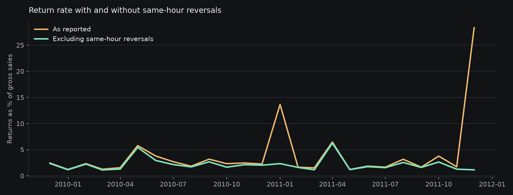
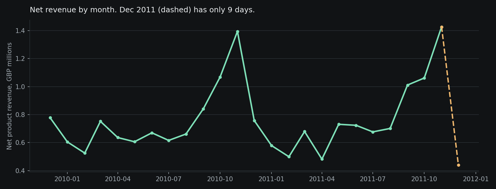
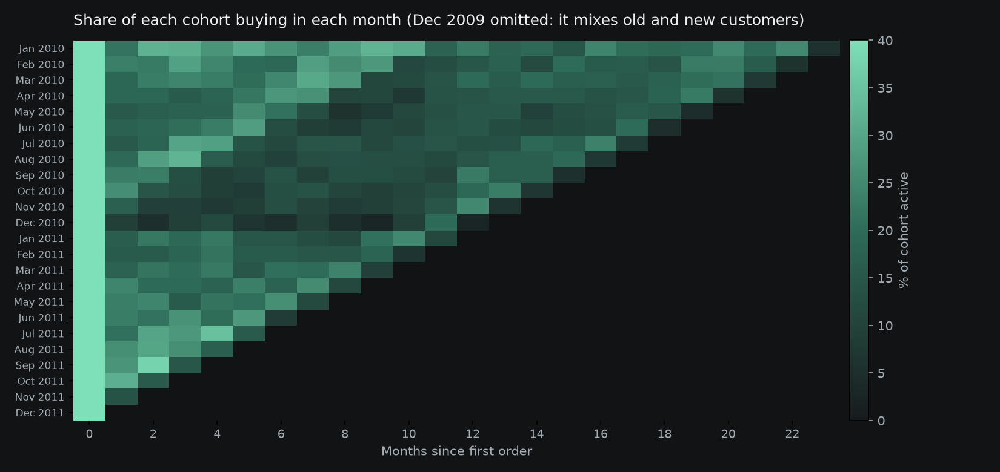
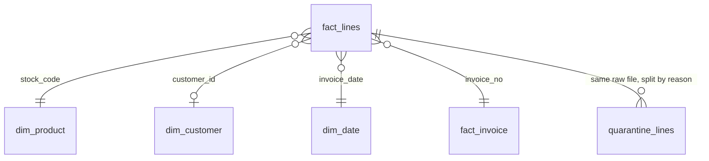

# E-commerce finance mart

[](https://github.com/VasilenData/ecommerce-finance-mart/actions/workflows/ci.yml)

Messy retail transactions go in. A normalized star schema, finance and customer marts, an Excel workbook and a self-serve sales explorer come out. Everything runs on one public dataset of 1,067,371 invoice lines from a UK online wholesaler (December 2009 to 9 December 2011).

**Try it:** [sales explorer](https://vasilendata.github.io/ecommerce-finance-mart/explorer/) (filter by period, country and customer type, export CSV) · [Excel workbook](docs/finance_workbook.xlsx) (live formulas, native charts) · [Tableau Public dashboard](https://public.tableau.com/app/profile/vasilen.kanchev/viz/E-CommerceFinanceMartSalesDashboard/E-CommerceFinanceMartsalesdashboard) · [metric definitions](docs/metrics.md) · [data quality report](docs/data_quality.md)

## What it demonstrates

| Skill | Where to look |
|---|---|
| Data normalization | `sql/10_staging.sql`, `sql/20_classify.sql`, `seeds/`: codes, descriptions, countries and line types cleaned, every rejected row kept with a reason |
| SQL | Four layered SQL files in DuckDB: staging, classification, core star schema, marts. Window functions, filtered aggregates, correlated `exists`, cohorts |
| Transactional and financial data | Invoices, credit notes, postage, fees, discounts and bad debt separated from product revenue. Kept and quarantined amounts reconcile to the raw file to the penny |
| Data models | `fact_lines`, `fact_invoice`, `dim_product`, `dim_customer`, `dim_date`, plus marts below |
| Analysis and charts | Findings below, drawn from the marts |
| Excel | `docs/finance_workbook.xlsx`: seven sheets, every KPI a formula, segment rollups with `SUMIF` and `COUNTIF`, three native charts. Formula results are checked against the SQL |
| Self-serve data product | `docs/explorer/`: one static page, sentence-style filters, shareable URLs, CSV export, a table behind every chart, definitions in the open |

## What the data showed

**Two order-entry mistakes distorted the return rate.** On 18 January 2011 one customer entered 74,215 ceramic jars (GBP 77,184) and a credit note for the same quantity followed 16 minutes later. On 9 December 2011 another entered 80,995 paper crafts (GBP 168,470) and reversed it after 12 minutes. A rule flags any return that mirrors a sale by the same customer within 60 minutes. It finds 989 such lines worth GBP 312,458, which is 44% of all credit-note value. The reported return rate is 3.65%. Without them it is 2.09%. January 2011 drops from 13.7% to 2.3%.



**Revenue edged up while orders fell.** For the same eleven months (January to November), net product revenue rose 2.3% from 2010 to 2011 (GBP 8,377,738 to 8,572,828) while orders fell 3.7% (18,077 to 17,407). The average order grew 7% instead (GBP 476 to 509). December 2011 is excluded because the data stops on the 9th.



**Revenue is concentrated.** 85.5% of gross sales are UK. Among the 5,852 registered customers with a purchase, the 1,470 "Champions" (25%) account for 70.6% of their revenue. 1,040 of 4,720 products (22%) make 80% of product revenue. About 13% of sales come from guest checkouts that have no customer id.

**Most customers do not come back.** Across monthly cohorts from 2010 on, an average of 20.4% buy again the following month and 16.7% are still buying twelve months later.



## Data model



`fact_lines` holds 1,027,008 kept lines, each typed (sale, return, shipping, discount, fee and so on). `quarantine_lines` holds 40,363 rejected lines with a reason. Marts: `mart_monthly`, `mart_customer_rfm`, `mart_cohort`, `mart_product`, `mart_country`, and the cube behind the explorer.

## What normalization fixed

| Problem in the raw file | Count |
|---|---:|
| Stock codes written in more than one case or with stray spaces | 174 |
| Descriptions with extra whitespace | 247,906 rows |
| Products with conflicting descriptions | 596 |
| Country labels like EIRE, RSA, USA mapped to clean names and regions | 18,694 rows |
| Exact duplicate rows quarantined | 34,335 |
| Zero or negative price lines, test products, zero-price non-product lines quarantined | 6,028 |
| Guest lines with no customer id (kept for revenue, left out of customer metrics) | 229,207 |

Full table and the 14 blocking checks: [docs/data_quality.md](docs/data_quality.md). The build stops if any check fails, for example if kept plus quarantined rows or amounts stop matching the raw file.

## Decisions and limits

- **Exact duplicates are treated as double-posted.** The 34,335 rows carry GBP 431,717, about 2.2% of gross sales. If they were real repeat lines, gross sales would be that much higher. They stay in `quarantine_lines`, so the assumption can be reversed in one place.
- **The 60-minute reversal rule is a judgment.** It needs the same customer, product, quantity and unit price. Returns that come days later count as real returns. Reversed orders stay in the fact table, flagged, never deleted.
- **December 2011 is 9 days.** Charts and the workbook mark it as partial. The first data month cannot separate new from existing customers, so new-customer counts start in January 2010.
- **Returns are timing, not cohorts.** A month's return rate is credit notes issued that month over sales that month. It is not the share of that month's sales that came back.
- **RFM edges are approximate.** Many customers share the same order count, so quintile boundaries are broken by spend and id. Treat segment sizes as a ranking aid.
- **Practice data, not employer data.** This is the public UCI Online Retail II dataset (CC BY 4.0) for one UK wholesaler, in GBP. No figure here comes from any company I have worked for.
- **BigQuery check.** The monthly sales table (643 rows) was loaded by hand into a BigQuery sandbox project in the EU region and reconciles to the mart: net sales GBP 18,927,399. The dataset is readable by any signed-in Google account (public practice data, not employer data). Run this in the BigQuery console (it picks the EU location itself) and expect 643 rows and 18,927,399:

  ```sql
  SELECT COUNT(*) AS months_rows, ROUND(SUM(net_sales)) AS net_sales_gbp
  FROM `finance-mart-demo.finance_mart.sales_monthly`;
  ```

  There is no Terraform deployment for it, and the Terraform elsewhere in my repos stays validated, not deployed.
- **Explorer scope.** The product table follows the period only, not country or customer type. Active customers are counted per month and cannot be summed across months, so the explorer shows a monthly average.

## Run it

```bash
pip install -r requirements-dev.txt
python -m mart.cli data      # downloads the 45 MB UCI file and flattens it (about 2 minutes)
python -m mart.cli all       # SQL layers, checks, report, workbook, explorer, charts (about 15 seconds)
python -m pytest -q          # 31 fixture tests, plus 1 end-to-end test on the real file
```

The SQL layers alone rebuild 1.07 million rows in about 7 seconds on a laptop-class machine. LibreOffice, if installed, recalculates the workbook so the formula results show in any viewer; without it Excel recalculates on open.

## Tests

`tests/` builds a 21-line fixture that covers every line class and checks each rule against hand-computed values: duplicate, missing key, test product, bad debt, non-product code, return, credit note with positive quantity, zero quantity, same-hour reversal versus a real return two days later, guest customers, cohorts, RFM and the monthly finance table. Writing the fixture exposed a real bug: a month with no returns produced a NULL net revenue. The full-data test confirms the checks pass on all 1,067,371 rows. A separate test deletes one fact row and proves the reconciliation check fails.

CI (`.github/workflows/ci.yml`) runs lint and the fixture tests on every push. `full-build.yml` is a manual run that downloads the data and rebuilds everything.

## Layout

```
sql/        four SQL layers, run in order
seeds/      country map and non-product stock code types
mart/       pipeline, checks, Excel, explorer, charts, CLI
tests/      fixture tests and the real-data test
docs/       explorer, workbook, metrics, data quality report, charts
```

## Open-source tools used

DuckDB (all SQL and the star schema), pandas (reading the source workbook), openpyxl (building the workbook with formulas and charts), matplotlib (README charts), pytest and ruff (tests and lint), LibreOffice (headless formula recalculation).
