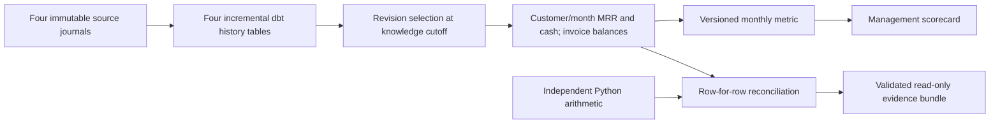

# Subscription reporting in dbt

The same subscription definitions now have a dbt implementation. Four append-only revision ledgers feed cutoff-selected states, monthly MRR movements, invoice balances, cash reconciliation and a versioned management metric. SQL runs in the selected database; Python supplies the fixture, transport contract and independent arithmetic oracle. No dbt model calls the Python report builder.

**Scope:** a synthetic correctness exercise, with DuckDB locally and a disposable PostgreSQL database in the dedicated CI workflow. PostgreSQL is a warehouse-backed exercise, not a managed cloud warehouse deployment. The historical 1.07-million-line retail release, Databricks comparison and subscription close releases remain unchanged. Human review, business adoption and measured financial impact remain pending.

[Read the dated execution evidence](dbt-warehouse/2026-11-13/) · [dbt models](../dbt_subscriptions/models/) · [exercise and independent oracle](../mart/dbt_warehouse.py) · [two-adapter CI](../.github/workflows/dbt-warehouse.yml)

## What changed, and why

A source correction can belong to an earlier business month. A delayed delivery can even have an older `recorded_at` than records already loaded. Filtering incrementally on either date would silently omit a legitimate invoice or payment.

The transport appends immutable `(record_id, revision)` identities and assigns a committed ingestion sequence. dbt's four history tables select only sequences above their own last loaded sequence. The staging views then choose the highest revision known at the requested cutoff. Downstream views recompute the bounded reporting window: this is incremental ingestion with transparent restatement, **not** an incremental aggregate optimization.

The exercise contains a concrete counterexample: a £50 January invoice and £40 January payment arrive after the April corrections. Both have older recorded timestamps than the previously loaded records. A maximum-recorded-timestamp filter would miss both; the transport sequence includes both, adding £10 to January's balance and every subsequent carried balance. A full refresh then produces exactly the same rows as the incremental path.



## Contract and boundaries

| Boundary | Contract |
|---|---|
| Source scope | Synthetic GBP data, complete subscription history, four feeds with exact schemas; source ownership and revision rules remain those in [SUBSCRIPTIONS.md](SUBSCRIPTIONS.md). |
| Identity | One immutable payload per `(record_id, revision)` per feed. Exact replay is ignored. Conflicting replay is rejected before any feed is appended. Database keys also reject duplicate ingestion sequences and revision identities. |
| Ordering | **One writer** allocates each feed's sequence inside the append transaction. Every committed journal is a complete ordered prefix; append and dbt builds run serially. This is not a PostgreSQL `nextval` watermark, arbitrary CDC offset or concurrent-writer protocol. Direct inserts, out-of-order commits, deleted history or reused sequences violate the contract. |
| Time | Business dates drive reporting months; UTC `recorded_at` drives what was known; ingestion sequence drives what has arrived. These three clocks have different meanings. |
| Output grain | Customer/month MRR movements; month-level MRR and cash bridges; one row per selected invoice; one shared metric and scorecard row per month. |
| Units and definitions | Integer pence; customer-level MRR movements preserve the existing new/reactivation/expansion/contraction/churn classification. Net invoice balance includes credits; it must not be described as gross unpaid exposure. Bookings and recognized revenue remain excluded. |
| Corrections and deletion | Append a later revision, never mutate history. Zero-value invoices and cancelled subscriptions retain the audit trail. There is no deletion/tombstone event in this source contract; adding one requires an explicit contract/model migration. |
| Empty periods | An empty source still produces zero-valued month rows. A new reporting month carries prior balances without inventing activity. |
| Publication | dbt operates in an isolated candidate schema. A dbt build is not an atomic multi-model financial close. Only the completed evidence bundle is renamed into a new output directory after all checks pass; previous published releases are untouched. |
| Access and scale | Random disposable schemas and a dedicated test database prevent accidental reuse of an existing mart. This does not demonstrate least-privilege production grants, managed warehouse cost, multiwriter transport or large-data performance. |

There is no lookback-window guess: history is retained and the small reporting window is recomputed. A future large-data version could rebuild only affected partitions, but would need a durable change manifest and proof that carried balances and downstream periods were included.

## Shared metric and definition impact

`monthly_subscription_metrics` is the single model used by `management_scorecard`. Its `growth_definition` variable accepts only two explicitly named versions:

- Version 1: `growth_mrr_cents = new_mrr_cents`.
- Version 2: `growth_mrr_cents = new_mrr_cents + reactivation_mrr_cents`.

This is a demonstration of a proposed definition change, not a claim that either definition is the company's agreed growth KPI. The same source produces a £90 March difference under version 2, entirely explained by customer C's reactivation. The financial bridges do not change. The observed scorecard changes by the same amount, and the report preserves dbt's actual model dependency graph. Stakeholder approval is deliberately not implied.

## Verification

Each adapter executes nine `dbt build` calls: empty source, baseline, exact replay, two corrections, historical-cutoff rewind, delayed backfill, full refresh, metric version 2, and a new reporting month. Every dbt node must pass. Four mart row sets are compared with two different references:

1. An independent Python implementation computes customer boundary states and sums raw invoice, payment and refund records without querying the dbt models or existing SQL. Hand-calculated fixtures separately cover refunds, credits and join multiplication.
2. The existing report builder is a **compatibility reference**, proving the published definitions are preserved. It is not presented as an independent SQL oracle because the dbt SQL was ported from it.

The workflow additionally compares all reports and definition deltas between the two executed adapters. Evidence includes source file hashes, package versions, the CI revision/run when applicable, per-node status, each scenario's complete rows and the observed dependency graph. A local record has `source_commit: uncommitted-local`; its exact file hashes identify the tested working tree. The dated evidence page distinguishes local runs from hosted results.

## Reproduce

Use a new virtual environment. Exact tested CLI/adapter versions are pinned in [requirements-dbt.txt](../requirements-dbt.txt): dbt Core 1.12.7, dbt-duckdb 1.11.1 and dbt-postgres 1.10.0; the DuckDB Python runtime is 2.0.0. The dependency file also pins psycopg 3.2.12 for fixture transport. The PostgreSQL 17 CI image is pinned by its observed container digest in the workflow. Do not install these into a project's unrelated existing environment.

```bash
python -m venv .venv-dbt
# Activate this environment using your platform's normal command.
python -m pip install -r requirements-dbt.txt pytest
python -m pytest -q tests/test_dbt_warehouse.py
python -m mart.dbt_warehouse --adapter duckdb --output dist/dbt-local
```

The output directory must not exist. PostgreSQL uses the same command with `--adapter postgres` and `FINANCE_TEST_DATABASE_URL` set in the process environment to a disposable database whose name ends in `_test`. Do not use an existing analytics or production database. The runner creates two random `fm_<id>` schemas and drops only those schemas after the exercise. Credentials never belong in command arguments, committed profiles or reports. The CI service supplies a disposable test password; it is not an account secret.

The runner retains a failed dbt log under ignored `dist/private-dbt-failures/`; review it locally before sharing. Successful public bundles contain reports and synthetic source files, not connection logs. Runtime dbt targets/logs and local telemetry identifiers are ignored.

## Engineering prompt used

Adapted from [dbt Labs' analytics-engineering skills](https://github.com/dbt-labs/dbt-agent-skills) and [Trail of Bits' property-based testing guidance](https://github.com/trailofbits/skills/tree/main/plugins/property-based-testing), with [dbt's incremental-model contract](https://docs.getdbt.com/docs/build/incremental-models) and the [DuckDB adapter implementation](https://github.com/duckdb/dbt-duckdb) as primary references:

> Preserve the existing financial definitions and historical releases. State source keys, grains, units, clock semantics, complete-history assumptions and exclusions before coding. Implement transformations in real dbt SQL and run them in isolated targets. Construct a late-arrival counterexample, prove replay and full-refresh equivalence row by row, and compare with independently calculated values. Trace one explicit definition change to its downstream report. Fail the release on a mismatched row or failed dbt node. Record exact source and runtime identity. Label fixture evidence, deployment scope and unverified human use honestly; do not add infrastructure merely for appearance.

These public references guide the work; they are not evidence of external review or an endorsement of this project.
