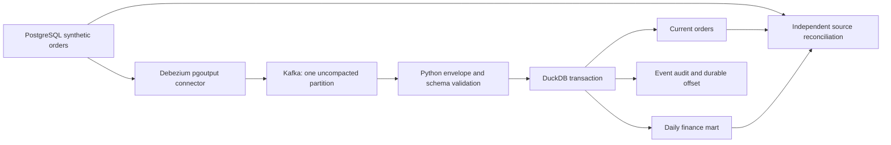

# Operational orders: change capture and reconciled reporting

This extension uses **synthetic orders** with a real PostgreSQL → Debezium → Kafka → DuckDB path. It is separate from the UCI Online Retail II dataset, historical workbook, explorer and customer-value study. It is a bounded integration/recovery exercise, not an employer system or a continuously operated service.

## Problem and contribution

An order changes after its first arrival: its amount may be corrected, a refund may arrive, it may be cancelled, or a mistakenly created order may be deleted. Repeated deliveries must not double revenue, and a consumer crash must not advance the checkpoint without its corresponding data.

The implementation captures PostgreSQL WAL changes using the Debezium connector. A Python consumer applies each Kafka record to the current order table, daily finance mart, event audit and durable offset **in the same DuckDB transaction**. Unknown source fields and missing offsets stop ingestion. The consumer resumes from its database-owned offset and retains enough event history to rebuild the result.



## Contract and metric definitions

[Machine-readable contract and dependencies](../operational/contract.json).

- **Grain:** one current order per `order_id`; the source table is not an accounting ledger.
- **Currency:** fixed GBP, integer pence. No binary floating-point money arithmetic. `_cents` is the conventional storage-field suffix.
- **Date:** explicit UTC business day supplied by the producer. No inference from capture time.
- **Net:** gross minus cumulative refund for orders whose current status is `paid`. Cancelled and deleted orders contribute zero. Negative net is forbidden by this specific source contract; that restriction does **not** apply to the historical UCI returns mart.
- **Deletes:** remove current state while preserving the captured history. A Kafka tombstone follows the Debezium delete event and has no additional financial effect.
- **Ownership:** this repository owns the demo source contract, transformations, tests and consumer. No other engineer or business approver is implied.
- **Completeness:** a new database starts at Kafka offset zero. The lab topic is not compacted. Any missing offset requires investigation and a new complete snapshot rather than silent skipping.

## Run the real integration exercise

Requires Docker Compose and Python 3.11+. The local PostgreSQL, Kafka and Connect ports are bound only to loopback. The password in the lab configuration is a disposable example credential, not a production secret. Use a fresh lab with no connector or prior sink database.

```bash
pip install -r requirements-cdc.txt
docker compose -f operational/compose.yml up -d --wait --wait-timeout 180
python -m operational.exercise --output dist/operational-cdc
docker compose -f operational/compose.yml down -v
```

The final command removes only the named disposable lab containers and their volumes. The output directory remains. The same exercise runs in [operational-cdc.yml](../.github/workflows/operational-cdc.yml), with a 20-minute job limit and a 30-day evidence artifact. The workflow records container image IDs and logs. A green fixture suite alone does not establish that this integration passed; inspect the actual run and its `evidence.json`.

### Acceptance checks

1. Capture an initial PostgreSQL snapshot and independently reconcile two orders and GBP 150.00.
2. Capture an insertion, gross correction, cumulative refund, cancellation, deletion and tombstone. Reconcile every current row and the daily totals against PostgreSQL.
3. Exit the consumer process **after its database writes but before commit**. Reopen the database and require the prior data, audit and offset to be unchanged. Consume the same Kafka record successfully on restart.
4. Kill the Debezium process with SIGKILL, make source changes while it is unavailable, restart it and reconcile the recovered result. Record elapsed recovery time as an observation of this exercise.
5. Replay the exact captured Kafka offsets into the existing target: zero new applications and unchanged results.
6. Rebuild an empty target from the captured event history and require identical rows, totals and offsets.

The final hand-calculated net is GBP 130.00: GBP 110.00 on 1 November and GBP 20.00 on 2 November. These are generated test amounts, not commercial results. `events.jsonl` contains the actual captured envelopes; `evidence.json` fingerprints those bytes, implementation files, code revision and runtime versions. Failed runs retain a failure record rather than a success claim.

## Review a source or business-rule change

```bash
python -m mart.cdc_impact orders.refund_cents
```

This reports the curated downstream dependencies and required checks. For `refund_cents`, the affected metrics are refunds and net, followed by the integration evidence report. It deliberately does not claim that the independent historical UCI workbook changes.

Use a new candidate database to replay events with a proposed rule. Compare order identities and per-day gross/refund/net totals with the existing version, inspect all changed dates, and rerun the recovery/reconciliation checks before switching consumers. Preserve the old database until the migration is accepted. The current implementation rejects an unexpected added source column: update the producer contract and consumer together, test the migration in a separate lab, and backfill from a complete snapshot if the old history cannot supply the new value. This is an explicit review procedure, not a SQLMesh deployment engine.

## Failure diagnosis

| Failure | What remains valid | Recovery |
|---|---|---|
| Bad envelope, field type or refund range | Previous consumer transaction and offset | Correct the source or implement and test a contract migration; do not skip the event |
| Missing Kafka offset | Previous complete target | Check retention/compaction/configuration; rebuild from a new complete snapshot |
| Sink process exits before commit | Previous current state, mart and offset | Restart the consumer against the same target and retained topic |
| Connector is interrupted | Last committed target | Restart connector; check its task status and PostgreSQL replication slot; reconcile after catch-up |
| Offset reused with different contents | Previous target | Treat as wrong/recreated topic or changed history; do not reuse this target |

## Boundaries

One local writer, one topic partition and one source table. Kafka and PostgreSQL are single-node test services without authentication beyond the lab database credential; they are not exposed publicly. The sink is not a concurrent serving database. A reader requiring a stable view across queries should use a read transaction.

The transaction protects this DuckDB sink; it is not a distributed exactly-once transaction across Kafka and PostgreSQL. Multiple source rows changed in one PostgreSQL transaction are consumed separately, so source transaction atomicity is not replicated. Connector recovery can redeliver events at new Kafka offsets; upserts/deletes converge after ordered replay, but intermediate current-state views during catch-up may be stale. The evidence verifies reconciliation after catch-up. The audit grows without a retention policy; long-running operation, WAL retention, access control, multiple currencies, partition scaling and financial ledger semantics require additional design.

## References

- [Debezium PostgreSQL connector](https://debezium.io/documentation/reference/3.0/connectors/postgresql.html): snapshots, WAL, delete envelopes and replica identity.
- [Debezium official tutorial](https://github.com/debezium/debezium-examples/tree/main/tutorial): connector deployment pattern.
- [DuckDB transactions](https://duckdb.org/docs/stable/sql/statements/transactions): local commit/rollback boundary.
- [GitLab Trusted Data Framework](https://handbook.gitlab.com/handbook/enterprise-data/platform/#trusted-data-framework): independent source-to-report validation.

The existing customer-value module already uses features strictly before the prediction date. Its additional regression test now checks that labelled training snapshots and unlabelled scoring snapshots produce identical feature columns for the same cutoff; no feature-store deployment is claimed.
