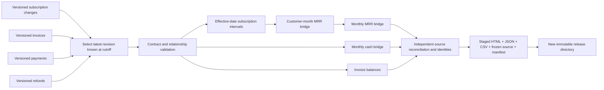

# Subscription analytics: preserve what was known at close

**[View the decision explorer](https://vasilendata.github.io/ecommerce-finance-mart/subscriptions/)** · [SQL](../sql/70_subscriptions.sql) · [source contract and publisher](../mart/subscriptions.py) · [independent fixtures](../tests/test_subscriptions.py) · [release manifest](subscriptions/2026-11-12-restatement/manifest.json)

An invoice correction changes billed amounts without collecting cash. A late subscription correction changes historical MRR without changing an earlier report's knowledge cutoff. Reporting these as one “revenue” number hides the reason for the difference.

This bounded product models **synthetic subscription changes, invoices, payments and refunds** in Python and DuckDB. It builds effective-dated subscription intervals, customer/month MRR movements, cash movements and invoice balances; selects revisions using an explicit knowledge cutoff; and publishes the explorer, JSON, CSVs and exact source bytes as one checked release. The original 1.07-million-line historical retail pipeline, workbook and explorer are unchanged.

## Scope and evidence

The checked-in exercise has four customers, five subscriptions, nine logical invoices, ten payments and one refund. There are 33 source versions including one subscription revision and one invoice revision. It is deliberately small enough to calculate by hand. This is evidence of model correctness and release behavior, **not throughput, commercial impact, an employer system or accounting compliance**.

The first release has **three knowledge cutoffs, three business months and 33 blocking reconciliation checks**. Tests cover the complete MRR movement vocabulary, multiple subscriptions per customer, split payments, refunds, overpayment credits, identical redelivery, conflicting duplicates, exact cutoff inclusion, effective-date/payment-date corrections and interrupted publication. The reproducible commands below run the current tests rather than treating this paragraph as a permanent test-count promise.

### Hand-calculated acceptance values

All displayed values below are GBP; source and SQL amounts are integer pence.

| Knowledge cutoff (UTC) | Jan closing MRR | Feb closing MRR | Mar closing MRR | Quarter billed | Quarter net cash | Closing invoice balance |
|---|---:|---:|---:|---:|---:|---:|
| 1 Apr 2026 00:00 | 180 | 240 | 180 | 750 | 710 | 40 |
| 3 Apr 2026 00:00 | 180 | 250 | 190 | 750 | 710 | 40 |
| 4 Apr 2026 00:00 | 180 | 250 | 190 | 760 | 710 | 50 |

- At the original close, January has new MRR of 180. February adds new 40 and expansion 50, less contraction 30: `180 + 40 + 50 - 30 = 240`. March reactivates 90 and churns 150: `240 + 90 - 150 = 180`.
- A subscription correction recorded on 2 April changes customer B's February rate from 50 to 60. Later reports show 10 more MRR in February and March. The 1 April snapshot remains unchanged when this version is appended.
- A corresponding invoice correction recorded on 3 April raises February billed amounts by 10. Cash remains 710 across the quarter; invoice balance rises from 40 to 50.
- The original closing balance of 40 consists of a 20 unpaid portion of customer D's March invoice and 20 returned to A as cash. A cash refund does not itself cancel A's invoice obligation.
- Customer C starts and cancels within February, producing zero month-end MRR. Its March return is a reactivation because the complete history includes a prior positive state.

Two additional test scenarios move a cancellation's effective date into April and move a payment's business date from January to February. Neither changes a report whose knowledge cutoff predates that correction.

### Explain the restatement, not just its total

The [restatement audit](subscriptions/2026-11-12-restatement/restatements.json) compares each later cutoff with the original close. It includes complete before/after source versions and every changed monetary cell at monthly, customer/month and invoice grain. The explorer filters monthly differences to the selected month while clearly labeling invoice balances as period-end values. Downloads include a machine-readable audit and a flat changes CSV; both share the report's frozen source hash and artifact manifest.

In the checked-in exercise, customer B's corrected rate contributes **£10 more closing MRR in February and March**, with no cash change. The corrected invoice adds **£10 billed and £10 outstanding**, also without collecting cash. The test suite separately moves a £100 payment between months: January cash falls £100, February cash rises £100, and quarter cash and period-end invoice balances remain unchanged.

The two comparisons run **44 additional blocking reconciliation checks**: customer changes must sum to each monthly MRR measure, and invoice-balance changes must sum to the period closing-balance change. Same-cutoff comparisons are empty; duplicate delivery and reordered input preserve the audit. Incompatible reporting windows, reversed knowledge cutoffs and corrupted customer deltas fail. The audit retains newly visible records even when they change no monetary result in the selected period.

These are net differences plus source-version provenance. They are **not a causal allocation of simultaneous changes**. The original immutable `2026-11-12` release remains available; the audited release is a separate directory.

## Contract

| Feed | Logical grain | Business date | References / value |
|---|---|---|---|
| `subscription_changes` | One logical change event per `record_id`, versioned | `effective_date` | Stable subscription/customer; active monthly rate or cancellation at zero |
| `invoices` | One invoice per `record_id`, versioned | `issued_date` | Stable customer; complete invoice face value |
| `payments` | One cash receipt per `record_id`, versioned | `paid_date` | One visible invoice; positive amount |
| `refunds` | One cash refund per `record_id`, versioned | `refunded_date` | One visible payment; positive amount |

Every record includes a positive integer `revision` and an explicit UTC `recorded_at`. Revisions start at one, are contiguous, and have strictly increasing knowledge timestamps. A revision is a complete replacement, not a delta. Its identity and parent entity cannot move. Identical `(record_id, revision)` deliveries are deduplicated; conflicting copies fail. Source order has no semantic effect. Unknown fields fail the schema contract.

For each logical record, the latest revision with `recorded_at <= knowledge_cutoff` is selected **before** transformations. Effective dates determine business state; they do not reveal a correction before it was recorded. Two different logical changes for the same subscription/effective date are ambiguous and fail. Intervals are `[effective_date, next_effective_date)`. Month-end means the instant immediately before the next month's start, so a change effective on 1 April does not change 31 March MRR.

Dates use `YYYY-MM-DD` in UTC. Report windows are complete calendar months `[start, end)` and must end no later than the knowledge cutoff. At most 120 months are supported. GBP is the only currency; monetary arithmetic uses integer pence. Each source amount and derived output must fit the browser's exact integer range. Identifiers start with a letter/digit and then use letters, digits, `_`, `.`, `:` or `-`; this also prevents formula-prefixed identifiers in spreadsheet CSV downloads.

Payments must reference an invoice visible at the same cutoff and cannot precede its issue date. Refunds must reference a visible payment, cannot precede its paid date, and cannot exceed that payment in total. Validation fails closed; there is no silent orphan quarantine or fabricated balancing entry. A late parent may therefore require an updated cutoff before a complete report can be produced.

`complete_subscription_history: true` is a required producer assertion. The code cannot prove the absence of unseen upstream events. Without complete history, a “new” versus “reactivation” distinction would be unsupported. This file contract is not a live source connector or completeness-monitoring service.

## Definitions and limits

- **MRR:** customer-aggregated, month-end recurring run rate; classify new, expansion, contraction, churn and reactivation after summing subscriptions. It excludes usage charges, taxes, FX, trials, annual-plan normalization and proration. Intramonth churn and return can net to zero in this bridge.
- **Billed amount:** latest visible invoice face value grouped by issue month. It is neither contract bookings nor recognized revenue.
- **Net cash:** receipts by paid date minus refunds by refunded date. It is not a measure of earned revenue.
- **Invoice balance:** invoice face value minus payments plus refunds. Negative balances remain visible as customer credits. Cash refunds do not cancel the invoice obligation; credit notes, write-offs and a general ledger are not modeled.
- **Bookings:** intentionally absent; contract total commitments and signing events are not in the source.
- **Recognized revenue:** intentionally absent; performance obligations and recognition schedules are not in the source. No IFRS/GAAP claim is made.
- **Forecasts, causal recommendations, tenant authorization and real payment integrations:** not implemented. The decision brief suggests review actions from observed synthetic movements; it does not claim intervention results.

## Lineage and impact analysis



| Source change | Affected calculation | Consumer artifacts |
|---|---|---|
| Subscription rate/status/effective date | Intervals; customer/month and total MRR; classification of future reactivation | MRR cards/bridge/customer table, `report.json`, two MRR CSVs |
| Invoice amount/issue date | Monthly billed amount, opening/closing balance, invoice balance | Cash cards/table, invoice table in JSON, cash and invoice CSVs |
| Payment amount/date | Monthly receipts, cash, balances; refund validity | Cash cards/table, cash and invoice CSVs, JSON |
| Refund amount/date | Monthly refunds, net cash, balances | Cash cards/table, cash and invoice CSVs, JSON |
| Any recorded-at/revision change | Which versions are eligible at a given knowledge cutoff | All dependent outputs and reconciliation checks |

The repository owner owns this synthetic contract, metric definitions and release checks. No real stakeholder sign-off, peer review or engineering collaboration is implied.

## Reproduce

```bash
pip install -r requirements-dev.txt
python -m pytest -q tests/test_subscriptions.py
python -m pytest -q tests/test_subscription_restatements.py
python -m mart.subscriptions --output dist/subscriptions-demo
# An explicit single snapshot or different complete-month window:
python -m mart.subscriptions --output dist/subscriptions-march \
  --as-of 2026-04-04T00:00:00Z --start 2026-03-01 --end 2026-04-01
```

Use a new output directory for each release. The default source is [the complete synthetic fixture](../subscriptions/demo.json); the default three cutoffs reproduce the table above. [`ci.yml`](../.github/workflows/ci.yml) runs the regression suite and generates an independently downloadable report bundle from that exact CI checkout.

The publisher freezes source bytes before parsing, validates every cutoff, and stages every output in a sibling directory. It publishes through one directory rename only after success. Existing releases are never overwritten. The failure test raises after CSV/JSON writes and before publication; the candidate remains invisible and the earlier bundle's bytes remain unchanged. This demonstrates application interruption handling, not power-loss durability, a distributed transaction or an atomic switch of GitHub Pages.

The manifest records exact source bytes, actual executed source-file hashes, runtime versions, artifact hashes and reconciliation count. `base_git_revision` identifies the checkout base; executed-file hashes disambiguate uncommitted development edits. Build timestamps and runtime identities can differ across runs. Verify the file hashes before using downloads; a Git branch name alone does not establish artifact provenance.

## Engineering references and reusable brief

The design applies [GitLab's analytics engineering responsibilities](https://handbook.gitlab.com/handbook/enterprise-data/organization/analytics-engineering/): conformed sources, shared definitions and reviewable models. Its independent small input/output fixtures follow the rationale in [dbt's unit testing documentation](https://docs.getdbt.com/docs/build/unit-tests). The existing Python/DuckDB stack is retained; dbt is a testing/design reference, not a new dependency or an implied deployment.

The implementation brief used here is concrete: “Define source and output grains, distinguish knowledge and effective time, separate business metrics, derive expected values by hand, then prove duplicate replay, late correction and failed-publication behavior before publishing evidence.” There is no universal online prompt that guarantees correctness; the executable contract, fixtures and published bytes are the reviewable result.
